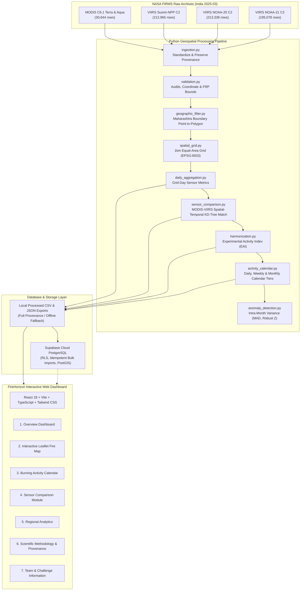

# FireHorizon — System Architecture

**NASA Space Apps Challenge 2026: Harmonization of MODIS and VIIRS Hot Spots**

---

## 1. High-Level System Architecture

---

## 2. Component Breakdown

### A. Python Geospatial Pipeline
- **Environment:** Python 3.11+
- **Core Libraries:** `pandas`, `numpy`, `scipy.spatial` (`cKDTree`), `shapely`, `pyproj`, `psycopg`
- **Projection Standard:** Equal-area `EPSG:6933` (World Cylindrical Equal Area) eliminates latitude distortion across the Indian subcontinent.

### B. Cloud Database (Supabase PostgreSQL)
- **Engine:** PostgreSQL 15+ hosted on Supabase
- **Security:** Strict Row Level Security (RLS) enabled on all 7 tables. Public anonymous access is read-only (`SELECT`). Bulk write operations use direct database connection strings via `psycopg`.
- **Performance Indexes:** B-tree indexes on `(activity_date)`, `(region_id)`, `(grid_id)`, and `(center_latitude, center_longitude)`.

### C. Frontend Web Application
- **Framework:** React + Vite + TypeScript + Tailwind CSS
- **Interactive Geospatial Visualization:** Leaflet & React Leaflet with dynamic layer switching (MODIS, VIIRS SNPP, VIIRS NOAA-20, VIIRS NOAA-21, Composite Activity).
- **Analytics & Time Series:** Recharts for sensor comparisons, FRP distribution, and diurnal profiles.
- **Data Resilience:** Direct Supabase client integration with automatic fallback to pre-computed JSON bundles for offline demonstration.
